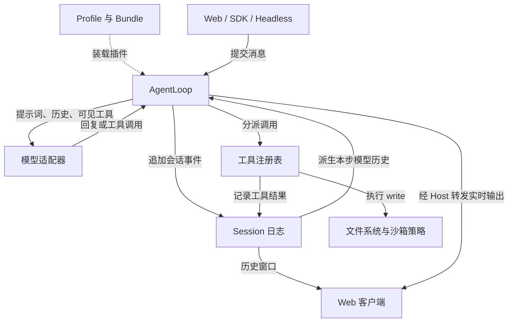

# 框架地图 · 顺着一条任务读 DeepSeek Harness

假设你在 Web 里输入“把会议结论写入 `notes.md`”。要解释最终出现的那句“已写入”，需要回答四个问题：谁把工具交给模型？谁真正写了文件？模型怎么得知结果？刷新页面后，那段对话又从哪里来？下图沿这条任务画出最短路径。箭头表示信息或调用的方向，配置箭头用虚线。

## 谁决定这个 Agent 会做什么？

启动时，Cordis 根据插件声明的依赖，把模型适配器、工具、会话存储、循环驱动器装入共享上下文 `ctx`。应用级 **profile** 选择一组 **bundle**，后面的配置层可以替换前面的插件配置。例如，`web` 与 `headless` 都使用基础包，`sdk-minimal` 则有独立的插件清单。创建 Agent 时，**preset** 还可以为这个 Agent 绑定自己的插件组合。遇到“同一应用里的两个 Agent 为什么能用不同工具”，要继续读 preset 和本步工具选择。[发行版组合](https://github.com/deepseek-ai/deepseek-harness/blob/4b399c39a6d1479cd84ca591b4d7c88e24d38a96/packages/util/official-bundles/src/bundles.ts#L10) · [Agent 绑定 preset](https://github.com/deepseek-ai/deepseek-harness/blob/4b399c39a6d1479cd84ca591b4d7c88e24d38a96/packages/preset/agent-preset-registry/src/index.ts#L291) · [工具选择](https://github.com/deepseek-ai/deepseek-harness/blob/4b399c39a6d1479cd84ca591b4d7c88e24d38a96/packages/core/tools/src/index.ts#L264)

## 谁知道一轮该走几步？

用户消息进入收件箱。AgentLoop 开启一个 **turn**，为当前 **step** 组装系统提示和可用工具，从 Session 派生模型历史，再经适配器请求模型。如果回复中含有工具调用，循环交给 `ctx.tools.execute()`。在写文件这个例子里，工具结果会进入下一步请求，模型据此才能说“已写入”或解释失败。一句话就可能触发两次模型请求；若首个输入在进入 step 前被拒绝，一个 turn 也可能包含零个 step。[回合与输入准入](https://github.com/deepseek-ai/deepseek-harness/blob/4b399c39a6d1479cd84ca591b4d7c88e24d38a96/packages/core/agent-loop/src/agent.ts#L332) · [从日志构造请求](https://github.com/deepseek-ai/deepseek-harness/blob/4b399c39a6d1479cd84ca591b4d7c88e24d38a96/packages/core/agent-loop/src/agent.ts#L718) · [回复里的工具调用](https://github.com/deepseek-ai/deepseek-harness/blob/4b399c39a6d1479cd84ca591b4d7c88e24d38a96/packages/core/agent-loop/src/agent.ts#L576)

## 模型有 `write`，为什么还可能写不进去？

`write` 定义对模型公开的参数，并按这次调用解析沙箱策略和目标路径；它通过 `ctx.fs.writeText()` 使用文件服务。基础包配置的 `fs-sandbox` 提供方检查目标是否可写，随后委托本地实现完成写入。这里体现了框架扩展能力的三种角色：**消费者**是 `write` 工具，**接口**是文件服务，**提供方**实现具体的访问策略和 I/O。模型能选中一个工具，以及目标文件能否写入，是沿链路先后作出的两个决定。[工具实现](https://github.com/deepseek-ai/deepseek-harness/blob/4b399c39a6d1479cd84ca591b4d7c88e24d38a96/packages/fs/tool-fs/src/write.ts#L113) · [文件服务](https://github.com/deepseek-ai/deepseek-harness/blob/4b399c39a6d1479cd84ca591b4d7c88e24d38a96/packages/fs/fs/src/index.ts#L104) · [写入检查](https://github.com/deepseek-ai/deepseek-harness/blob/4b399c39a6d1479cd84ca591b4d7c88e24d38a96/packages/fs/fs-sandbox/src/index.ts#L80)

## 同一条历史，为什么能有不同视图？

Session 按顺序追加事件。模型历史是日志的一种投影，即按规则读取事件后得到的结果。业务插件也可以注册自己的投影，例如团队插件从根会话事件得知当前是否启用任务板。基础包选择 JSONL 作为会话持久化后端；同一份配置里还有 SQLite 查询插件，其全文检索默认设为 `openAt: never`。调查一个会话“存在哪里”和“能否按正文搜索”时，应分别检查这两项配置。[模型历史投影](https://github.com/deepseek-ai/deepseek-harness/blob/4b399c39a6d1479cd84ca591b4d7c88e24d38a96/packages/core/session/src/index.ts#L760) · [持久化与查询的默认设置](https://github.com/deepseek-ai/deepseek-harness/blob/4b399c39a6d1479cd84ca591b4d7c88e24d38a96/packages/bundle/base/cordis.patch.yml#L142)

试着预测一次上下文压缩会改写哪一条旧消息。源码里的答案是**追加两条记录**：基本压缩实现先写 `compaction/summary`，保存摘要和被覆盖的序号；随后追加一条带 `surfaceOp: replace` 的检查点消息，指明在后续模型历史里替换哪一段。原事件依然可以用于回看。这两条是成功提交摘要时连续写入的核心记录，完整压缩流程另有开始与结束事件。[摘要与检查点](https://github.com/deepseek-ai/deepseek-harness/blob/4b399c39a6d1479cd84ca591b4d7c88e24d38a96/packages/compaction/compaction-basic/src/region.ts#L497)

## 任务做大了，怎样交给多个 Agent？

子代理服务管理父子关系、委派和通信。基础包提供两种进程内配置：`spawn` 从新的上下文开始，`fork` 继承父会话已有的对话上下文。需要共同维护任务时，团队插件再提供共享任务板；它从整棵子代理树的根 Session 读取启用状态，服务默认值为关闭。需要用脚本组织多次委派时，Workflow 工具将脚本交给配置的引擎执行，当前基础包选择 PTC 引擎与 `spawn` 提供方。[委派与工作流配置](https://github.com/deepseek-ai/deepseek-harness/blob/4b399c39a6d1479cd84ca591b4d7c88e24d38a96/packages/bundle/base/cordis.patch.yml#L374) · [团队启用状态](https://github.com/deepseek-ai/deepseek-harness/blob/4b399c39a6d1479cd84ca591b4d7c88e24d38a96/packages/team/agent-team/src/index.ts#L70) · [Workflow 的调用约定](https://github.com/deepseek-ai/deepseek-harness/blob/4b399c39a6d1479cd84ca591b4d7c88e24d38a96/docs/subsystems/workflow.zh.md#L11)

## 刷新页面，或者换用 Python，会发生什么？

Web 的 Host 负责会话状态和执行。浏览器通过类型化远程接口提交操作，React 组件订阅客户端状态。刷新时，Host 的 `follow()` 先注册监听，再读取会话快照，先交付快照，随后交付尚未覆盖的增量，因此读取历史期间新到的事件也能接上。生成中的文本走实时流，回复完成时再把完整回复与对应的流记录写入 Session。[Web 客户端分层](https://github.com/deepseek-ai/deepseek-harness/blob/4b399c39a6d1479cd84ca591b4d7c88e24d38a96/docs/subsystems/web-client.zh.md#L9) · [订阅与快照顺序](https://github.com/deepseek-ai/deepseek-harness/blob/4b399c39a6d1479cd84ca591b4d7c88e24d38a96/packages/api/session-controller/src/web/controller.ts#L32) · [回复提交](https://github.com/deepseek-ai/deepseek-harness/blob/4b399c39a6d1479cd84ca591b4d7c88e24d38a96/packages/core/agent-loop/src/agent.ts#L564)

Electron 窗口复用 Web 应用，私有 Desktop Host 通过共享启动器运行 `desktop` profile。TypeScript 与 Python SDK 默认通过 `sdk` profile 启动进程，以 JSON-RPC 驱动 Agent。自动化客户端还可以使用 `acp` profile。读到这些不同入口时，可以回到同一个问题：当前入口向循环投递了什么，又订阅了哪些结果？[桌面入口](https://github.com/deepseek-ai/deepseek-harness/blob/4b399c39a6d1479cd84ca591b4d7c88e24d38a96/apps/desktop-host/src/index.ts#L48) · [各端启动约定](https://github.com/deepseek-ai/deepseek-harness/blob/4b399c39a6d1479cd84ca591b4d7c88e24d38a96/docs/architecture.zh.md#L41)

## 从这里继续

想核对“哪些插件真正装上了”，做[第一课的配置实验](../notes/01-profiles-and-agent-loop.md)。想数清楚“这轮到底请求了几次模型”，看[第二课的回合实验](../notes/02-turn-and-tools.md)。要找其他能力，按动作查上游包地图：`skill` 加载技能，`mcp` 接入外部工具，`goal` 在同一会话中推进目标，`schedule` 安排后续触发。[上游包地图](https://github.com/deepseek-ai/deepseek-harness/blob/4b399c39a6d1479cd84ca591b4d7c88e24d38a96/packages/README.zh.md#L29)

[第三课 · 对照压缩前后的会话](../notes/03-context-compaction.md) · [返回首页](../README.md)
