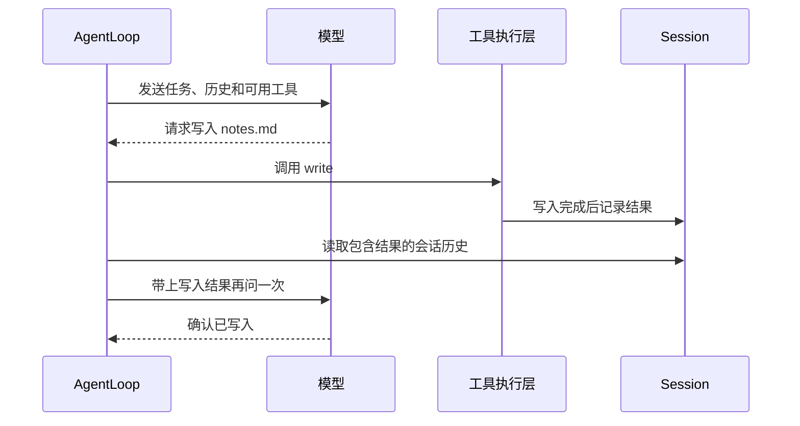

# 框架地图 · 谁把文件写到了磁盘？

你在网页里说“把会议结论写入 `notes.md`”。模型可以提出写文件的请求，真正写入磁盘的是文件工具。DeepSeek Harness 负责把请求交给工具，再把结果送回模型。

## 应用启动时，工具从哪来？

**Cordis** 是装配插件的框架。模型、工具、会话存储都通过插件接入。启动命令选择一份应用配置（profile），配置列出要加载的插件包（bundle）。网页模式和无界面模式会加载同一个基础包，所以都能运行同一套对话循环。每个 AI 助手（Agent）还可以用自己的预设（preset）加载不同的插件。[内置配置](https://github.com/deepseek-ai/deepseek-harness/blob/4b399c39a6d1479cd84ca591b4d7c88e24d38a96/packages/util/official-bundles/src/bundles.ts#L10) · [Agent 如何绑定预设](https://github.com/deepseek-ai/deepseek-harness/blob/4b399c39a6d1479cd84ca591b4d7c88e24d38a96/packages/preset/agent-preset-registry/src/index.ts#L291)

## 发出指令后，谁在做事？

**AgentLoop** 是推动任务的循环。它向模型提问，根据回答调用工具，接着决定要不要再问一次。**Session** 是按顺序记录消息、工具调用和结果的会话日志。下图是一次成功写入的过程。

模型能选择 `write`，只说明这个工具可用。实际执行时，文件服务还会检查目标路径是否允许写入。如果权限检查失败，下一步模型读到的是失败结果，也就可以向用户解释原因。[循环如何分派工具](https://github.com/deepseek-ai/deepseek-harness/blob/4b399c39a6d1479cd84ca591b4d7c88e24d38a96/packages/core/agent-loop/src/agent.ts#L576) · [写入前的权限检查](https://github.com/deepseek-ai/deepseek-harness/blob/4b399c39a6d1479cd84ca591b4d7c88e24d38a96/packages/fs/fs-sandbox/src/index.ts#L80)

## 刷新页面后，会话怎么接上？

默认配置把 Session 保存为 JSONL 文件，每行一条记录。网页刷新时，服务端先监听新事件，再读取已有记录。浏览器由此可以先显示历史，再接上读取历史期间到达的新内容。[存储配置](https://github.com/deepseek-ai/deepseek-harness/blob/4b399c39a6d1479cd84ca591b4d7c88e24d38a96/packages/bundle/base/cordis.patch.yml#L142) · [刷新时如何订阅](https://github.com/deepseek-ai/deepseek-harness/blob/4b399c39a6d1479cd84ca591b4d7c88e24d38a96/packages/api/session-controller/src/web/controller.ts#L32)

回复生成时，网页可以先显示陆续收到的文字。回复结束后，框架把完整消息记入日志，供刷新后读取。[回复如何保存](https://github.com/deepseek-ai/deepseek-harness/blob/4b399c39a6d1479cd84ca591b4d7c88e24d38a96/packages/core/agent-loop/src/agent.ts#L564)

同一份日志也决定模型下次会看到什么。会话太长时，框架把摘要追加到日志，标出它替代的旧消息。模型下次读取摘要，人仍能回看原文。[第三课 · 上下文压缩](../notes/03-context-compaction.md)

## 怎样接入或扩展这套循环？

| 想做什么 | 从哪里入手 |
| --- | --- |
| 从桌面或代码发起任务 | 桌面端复用网页界面。Python 和 TypeScript 都提供 SDK，让程序也能提交任务、接收结果。[启动入口](https://github.com/deepseek-ai/deepseek-harness/blob/4b399c39a6d1479cd84ca591b4d7c88e24d38a96/docs/architecture.zh.md#L41) |
| 把一部分工作交给另一个 Agent | `spawn` 让子 Agent 从新会话开始，`fork` 让它继承当前对话。团队插件可以提供共享任务板，Workflow 插件可以用脚本安排多次委派。[委派与工作流配置](https://github.com/deepseek-ai/deepseek-harness/blob/4b399c39a6d1479cd84ca591b4d7c88e24d38a96/packages/bundle/base/cordis.patch.yml#L374) |
| 接入已有的外部工具 | MCP 插件把外部服务提供的工具注册给 Agent，后续仍走同一条调用流程。[各类插件的用途](https://github.com/deepseek-ai/deepseek-harness/blob/4b399c39a6d1479cd84ca591b4d7c88e24d38a96/packages/README.zh.md#L29) |

[第一课 · 应用如何组装](../notes/01-profiles-and-agent-loop.md) · [第二课 · 跟踪一次工具调用](../notes/02-turn-and-tools.md) · [返回首页](../README.md)
