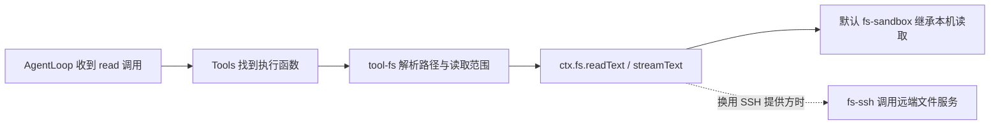

# 万物皆插件 · DeepSeek Harness 怎样把一堆插件变成一个 Agent？

在默认的 Web 配置里，全局的 `tool-fs` 明明被设成了 `disabled: true`，新建的标准 Agent 却能调用 `read`。在基础配置里，文件工具甚至排在文件系统实现前面。框架怎么知道何时启动工具、它应该出现在哪里、最终由谁打开文件？顺着一个 `read`，这三个问题都有具体的代码答案。[Web 关闭全局文件工具](https://github.com/deepseek-ai/deepseek-harness/blob/4b399c39a6d1479cd84ca591b4d7c88e24d38a96/packages/bundle/web-app/cordis.patch.yml#L573-L574) · [基础配置中的工具](https://github.com/deepseek-ai/deepseek-harness/blob/4b399c39a6d1479cd84ca591b4d7c88e24d38a96/packages/bundle/base/cordis.patch.yml#L302)

## DSH 把哪些决定交给了插件？

DSH 把循环、工具注册表、模型服务和会话存储都列入配置。`dsh-base` 用同一种配置条目挂载 `tools`、`system-prompt`、`agent-loop` 和 `fs-sandbox`。要扩展一次模型调用，可以挂监听器；要换文件系统，可以换提供方；要换默认执行循环，也有单独的服务实现可替换。实现必须满足调用者使用的服务接口和会话事件约定。[架构说明](https://github.com/deepseek-ai/deepseek-harness/blob/4b399c39a6d1479cd84ca591b4d7c88e24d38a96/docs/architecture.zh.md#L7-L23) · [这四个实际条目](https://github.com/deepseek-ai/deepseek-harness/blob/4b399c39a6d1479cd84ca591b4d7c88e24d38a96/packages/bundle/base/cordis.patch.yml#L524-L554)

这里有三个容易混在一起的名字。**插件**是 Cordis 可以挂载、停用的一份代码，例如 `tool-fs`。**服务**是其他插件可以通过上下文调用的能力，例如 `ctx.fs`。**工具**是模型可以请求执行的动作，例如 `read`。一个插件可以提供一个服务，也可以消费几个服务，注册多个工具。模型只需要知道工具的名字、参数和用途。

## 1. 装配：同一个 read 为什么出现在不同位置？

`profile` 决定应用启动时叠加哪些配置包。固定版本中，`headless` 使用 `base + headless`，`web` 使用 `base + web-app`。后叠加的包可以按条目 ID 修改前面的配置。基础层为两种应用提供同一个 `ctx.fs` 实现，文件工具挂在哪一层则由应用决定。[内置 profile 模板](https://github.com/deepseek-ai/deepseek-harness/blob/4b399c39a6d1479cd84ca591b4d7c88e24d38a96/packages/util/official-bundles/src/bundles.ts#L10-L25) · [启动配置的合并顺序](https://github.com/deepseek-ai/deepseek-harness/blob/4b399c39a6d1479cd84ca591b4d7c88e24d38a96/packages/boot/app-boot/src/profile.ts#L5)

| 跟踪 `read` 的位置 | Headless | Web 的标准 Agent |
| --- | --- | --- |
| Host 启动 | 使用基础层挂载的 `tool-fs` | Web 配置关闭这条全局注册 |
| 创建 Agent | 可以看到全局注册的文件工具 | 控制器绑定选定的 preset，`standard` 预设里另有一条 `tool-fs` |
| 执行工具 | 通过 `ctx.fs` 读文件 | 同样通过 `ctx.fs` 读文件 |

**profile 决定应用装什么，preset 决定某个 Agent 继承哪组能力。** 预设注册表把 Agent 的作用域接到所选预设版本上。多个 Agent 可以共享一个版本；更新预设后，已经绑定旧版的 Agent 仍然使用旧版。于是网页可以给不同 Agent 提供不同的工具清单，同时共享同一套文件服务。[standard 预设中的文件工具](https://github.com/deepseek-ai/deepseek-harness/blob/4b399c39a6d1479cd84ca591b4d7c88e24d38a96/packages/bundle/web-app/presets/standard.patch.yml#L27-L31) · [Web 绑定预设](https://github.com/deepseek-ai/deepseek-harness/blob/4b399c39a6d1479cd84ca591b4d7c88e24d38a96/packages/api/session-controller/src/agent.ts#L272) · [共享与更新预设的测试](https://github.com/deepseek-ai/deepseek-harness/blob/4b399c39a6d1479cd84ca591b4d7c88e24d38a96/packages/preset/agent-preset-registry/tests/registry.spec.ts#L17)

## 2. 注入：谁告诉 read 文件系统已经就绪？

`tool-fs` 直接声明四个运行时依赖。等它们就绪，Cordis 才调用插件的 `apply(ctx, config)`。启用 `read` 时，`applyReadTool()` 贡献一段给模型的使用说明，并调用 `ctx.tools.register(...)` 注册工具定义及执行函数。[依赖声明与 apply](https://github.com/deepseek-ai/deepseek-harness/blob/4b399c39a6d1479cd84ca591b4d7c88e24d38a96/packages/fs/tool-fs/src/index.ts#L23-L29) · [注册说明和工具](https://github.com/deepseek-ai/deepseek-harness/blob/4b399c39a6d1479cd84ca591b4d7c88e24d38a96/packages/fs/tool-fs/src/read.ts#L69-L85)

```ts
export const inject = ['tools', 'fs', 'systemPrompt', 'workingDirectory']
```

`ctx.fs` 怎么来的？在类型层，文件服务用 TypeScript 声明合并告诉编辑器：`Context` 有一个 `fs: FileSystem` 属性。在运行时，`FileSystem` 调用 `super(ctx, 'fs')`，由 Cordis 把已挂载的具体对象登记到这个服务名下。只引入类型，编辑器可以识别方法，却不会凭空启动一个文件系统。[Context 的类型声明](https://github.com/deepseek-ai/deepseek-harness/blob/4b399c39a6d1479cd84ca591b4d7c88e24d38a96/packages/fs/fs/src/index.ts#L53) · [运行时服务名](https://github.com/deepseek-ai/deepseek-harness/blob/4b399c39a6d1479cd84ca591b4d7c88e24d38a96/packages/fs/fs/src/index.ts#L104) · [Cordis 登记服务实例](https://github.com/deepseek-ai/deepseek-harness/blob/4b399c39a6d1479cd84ca591b4d7c88e24d38a96/vendor/cordis/src/service.ts#L38)

运行中的 Cordis 为每个插件实例维护一个 **Fiber**，里面记录插件依赖哪些服务、本次绑定哪些实现、卸载时要执行哪些清理函数。提供方登记一个服务后，Cordis 按服务名和隔离范围找到依赖它的 Fiber。Fiber 检查所需实现是否齐全，并把自身修订号和这些实现的唯一标识组成一个版本标记。缺一个就等待；标记未变可以继续使用当前实例；标记变化才需要切换。这就解释了为什么 YAML 可以先列消费方、后列提供方。[服务变更如何通知](https://github.com/deepseek-ai/deepseek-harness/blob/4b399c39a6d1479cd84ca591b4d7c88e24d38a96/vendor/cordis/src/reflect.ts#L351-L369) · [依赖检查与版本标记](https://github.com/deepseek-ai/deepseek-harness/blob/4b399c39a6d1479cd84ca591b4d7c88e24d38a96/vendor/cordis/src/fiber.ts#L625-L665)

## 3. 执行：真正打开文件的是谁？

对于一个已知大小的小文件，`read` 的执行函数解析参数、解析路径、检查文件状态，随后调用 `ctx.fs.readText(target, signal)`。大文件或大小未知时走 `streamText()`。展示多少行、怎样截断属于工具的职责，实际从哪里取得字节由当前文件系统实现负责。[read 的执行分支](https://github.com/deepseek-ai/deepseek-harness/blob/4b399c39a6d1479cd84ca591b4d7c88e24d38a96/packages/fs/tool-fs/src/read.ts#L138-L153)



默认基础配置挂的是 `SandboxedFileSystem`。它继承 `LocalFileSystem` 的读取实现，另外对文件变更检查策略。源码中也能找到 `SshFileSystem` 对同一接口的实现：它把 `readText` 转成远端的 `fs.readText` 调用。文件工具只依赖共同的 `FileSystem`。这就是上游所说的三个角色：服务定义规定可调用的方法，提供方实现方法，消费方把它们用于一个具体任务。[默认提供方](https://github.com/deepseek-ai/deepseek-harness/blob/4b399c39a6d1479cd84ca591b4d7c88e24d38a96/packages/fs/fs-sandbox/src/index.ts#L1-L8) · [本机读取](https://github.com/deepseek-ai/deepseek-harness/blob/4b399c39a6d1479cd84ca591b4d7c88e24d38a96/packages/fs/fs-local/src/index.ts#L190) · [SSH 读取](https://github.com/deepseek-ai/deepseek-harness/blob/4b399c39a6d1479cd84ca591b4d7c88e24d38a96/packages/ssh/fs-ssh/src/index.ts#L44)

## 4. 卸载：提供方消失，为什么不会留下一个坏工具？

假设 `read` 依赖的服务已经卸载，工具清单却还在。模型会看到一个执行不了的工具。DSH 为此把**可见位置**和**清理责任**都绑到注册时的上下文上。`ToolsService.register()` 把定义插入对应作用域的工具表；底层的 `ScopedLayers.effect()` 同时把撤销操作登记给当前 Fiber。插件退出，Cordis 可以准确撤掉它贡献的条目。例如上游测试在 Agent 的上下文里同时注册了工具和提示词。释放这个 Agent 后，两项贡献一起消失，全局提示词依旧可用。[作用域实测](https://github.com/deepseek-ai/deepseek-harness/blob/4b399c39a6d1479cd84ca591b4d7c88e24d38a96/packages/core/agent-loop/tests/scope-lifecycle.spec.ts#L258-L282)。[工具注册](https://github.com/deepseek-ai/deepseek-harness/blob/4b399c39a6d1479cd84ca591b4d7c88e24d38a96/packages/core/tools/src/index.ts#L128-L153) · [作用域与撤销操作](https://github.com/deepseek-ai/deepseek-harness/blob/4b399c39a6d1479cd84ca591b4d7c88e24d38a96/packages/core/scope/src/store.ts#L219-L257)

还有一个顺序问题：消费方自己的清理代码也可能需要那个即将消失的服务。激活时，Cordis 固定本轮使用的服务对象，并把消费方记入提供方的依赖者集合。卸载时先等消费方收尾，再释放提供方。上游用例故意暂停消费方的清理，此时提供方仍然存活；放行后，记录严格为 `['consumer', 'provider']`。卸载和重启都验证了这个顺序。[建立依赖关系](https://github.com/deepseek-ai/deepseek-harness/blob/4b399c39a6d1479cd84ca591b4d7c88e24d38a96/vendor/cordis/src/fiber.ts#L703-L713) · [按依赖顺序收尾](https://github.com/deepseek-ai/deepseek-harness/blob/4b399c39a6d1479cd84ca591b4d7c88e24d38a96/vendor/cordis/src/fiber.ts#L734-L765) · [卸载与重启的对照实验](https://github.com/deepseek-ai/deepseek-harness/blob/4b399c39a6d1479cd84ca591b4d7c88e24d38a96/scripts/cordis-core-lifecycle.spec.ts#L74-L99)

## 5. 扩展：什么时候换服务，什么时候监听事件？

**改“谁做这件事”，看服务。改“已有动作怎样进行”，看事件。** 把本机文件读取改成 SSH 读取，要提供另一个 `ctx.fs` 实现。如果想在模型输出前加一个片段，可以监听 `llm/stream`：用 `next()` 取得下游的流，返回的新流先发自己的片段，再依次转发适配器产生的片段。另一个测试让监听器自行产生全部回复事件，全程不调用 `next()`；即使该路由没有已注册的适配器，会话仍收到了固定回复 `owned`。[对照一：包装适配器输出](https://github.com/deepseek-ai/deepseek-harness/blob/4b399c39a6d1479cd84ca591b4d7c88e24d38a96/packages/llm/llm/tests/service.spec.ts#L1452) · [对照二：接管一次调用](https://github.com/deepseek-ai/deepseek-harness/blob/4b399c39a6d1479cd84ca591b4d7c88e24d38a96/packages/core/agent-loop/tests/request-reconstruction.spec.ts#L463)

排查“为什么这个 Agent 看不到 `read`”，可以沿装配过程往下找。先看生效的 profile 和 preset 有没有挂载它，再看 `inject` 的服务是否就绪、工具注册在哪个作用域。注册成功后还要看本步骤最终给模型声明了哪些工具，工具的启用条件也可能影响结果。等到日志已经出现模型请求 `read`，才转向执行函数，检查路径、权限和返回值。[本步骤怎样选择工具](https://github.com/deepseek-ai/deepseek-harness/blob/4b399c39a6d1479cd84ca591b4d7c88e24d38a96/packages/core/tools/src/index.ts#L247-L280)

## 实验：先装消费者，等提供方晚到，再撤掉它

上游准备了两个很小的真实插件：一个提供 `greeter` 服务，一个依赖它并注册 `greet` 工具。用这两个插件能把依赖变化看得比完整的文件系统更清楚。在装好开发依赖的**上游源码仓库**根目录运行，无需模型密钥。[两个插件的代码](https://github.com/deepseek-ai/deepseek-harness/blob/4b399c39a6d1479cd84ca591b4d7c88e24d38a96/packages/extensions/cordis-host-runner/tests/helpers.ts#L212-L235) · [测试中的实际调用](https://github.com/deepseek-ai/deepseek-harness/blob/4b399c39a6d1479cd84ca591b4d7c88e24d38a96/packages/extensions/cordis-host-runner/tests/composition.spec.ts#L42-L85)

```sh
./node_modules/.bin/vitest run packages/extensions/cordis-host-runner/tests/composition.spec.ts \
  -t 'consumer first|stopping the provider|running the provider again'
```

三个用例依次验证：只挂消费方时，它等待 `greeter`，工具清单查不到 `greet`；补上提供方后，实际调用得到 `hi late`；停止提供方，工具随之消失，重新提供服务后再次调用得到 `hi again`。终端应显示 `3 passed`。这组结果把“万物皆插件”落实成了一条可观察的规则：**能力能否被调用，取决于此刻有哪些实现就绪，以及调用者能看到哪一组注册。**

[继续读 AgentLoop](agent-loop.md) · [核心组件索引](deep-dive-roadmap.md)
